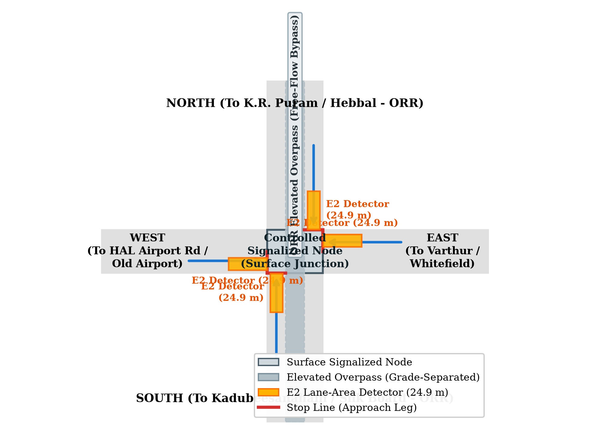
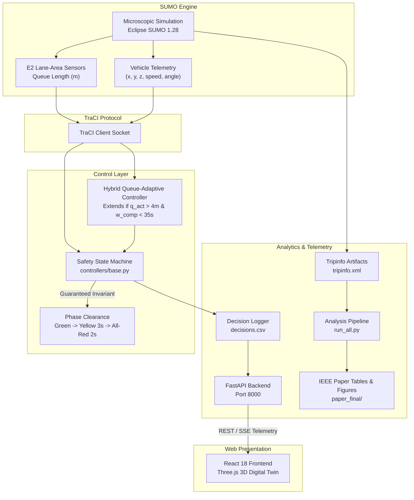

# 🚦 Phasora

### Adaptive Traffic Signal Intelligence with Clearance Invariants, Queue Projections, and Confirmatory Statistical Verification

[](https://eclipse.dev/sumo/)
[](./paper_final/DP1_Paper_IEEE_Final.docx)
[](./tests/)
[](https://www.python.org/)
[](https://fastapi.tiangolo.com/)
[](https://react.dev/)

[**IEEE Manuscript**](./paper_final/DP1_Paper_IEEE_Final.docx) · [**Study Results (384 Runs)**](./results/research/exp_marathahalli_improve_final/) · [**Master Runner**](./analysis/paper_final/run_all.py) · [**3D Digital Twin**](./frontend/)

> 🚦 **Academic & Simulation Integrity:** Built for **Alliance University B.Tech AI & DS Design Project 1 (DP1)**. All queue detectors and vehicle arrivals are simulated microscopically in Eclipse SUMO (calibrated against Bengaluru Marathahalli junction geometry and BTP signal timing). Every phase change strictly guarantees physical clearance intervals (`GREEN -> YELLOW (3s) -> ALL-RED (2s) -> GREEN`). All empirical metrics are derived from a pre-registered 384-run confirmatory matrix across held-out evaluation seeds (131–138). Zero hand-edited numbers.

---

## 📌 Overview

Urban intersections in high-density corridors like Bengaluru's Outer Ring Road suffer from acute gridlock under traditional fixed-time signal plans:
- **Fixed-time splits** waste green time on empty approaches while queues spill across upstream intersections.
- **Analytical Webster plans** assume stationary, Poisson arrival rates and cannot respond to transient lane closures, peak ramps, or directional demand surges.
- **Aggressive actuation** often leads to starvation on competing approaches ("green-holding monopolies") and excessive switching frequency that destroys throughput via clearance loss.

**Phasora** solves this through a safety-invariant, hybrid queue-adaptive control architecture:

- **Guaranteed Physical Clearance**: A formal state machine in `controllers/base.py` enforces `GREEN -> YELLOW (3s) -> ALL_RED (2s) -> GREEN(other axis)`. Switches directly between green phases or dual-axis green displays are mathematically impossible.
- **Anti-Monopoly Fairness Cap**: An active phase can request green extensions ($3\,\text{s}$ increments) based on continuous lane-area queue measurements ($E_2$ detectors), but an adaptive competing wait threshold ($\le 35\,\text{s}$) terminates extensions before competing approaches starve.
- **Short-Horizon Queue Projection**: Evaluates counterfactual queue dynamics over a rolling time window, balancing the immediate marginal benefit of an extension against inter-phase switching and clearance overhead.
- **Multi-Policy Benchmarking**: Directly evaluates 8 discrete control paradigms—including fixed time, Webster measured, Webster dynamic recalculation, SUMO native actuated, heuristic queue extension, and RL Deep Q-Networks.
- **Seed-Clustered Bootstrap Statistics**: Evaluated on 384 confirmatory runs over 8 held-out seeds (131–138) with Holm-Bonferroni family-wise error rate corrections.
- **Interactive 3D Digital Twin**: Full-stack web telemetry with React Three Fiber, rendering real-time vehicle kinematics, elevation-accurate flyover geometry, and live signal phase states.

---

## 🖥️ 3D Digital Twin & Operations Dashboard

[](./paper_final/figures/fig1_network_schematic.png)

The project includes a production-grade full-stack operations suite:

- **3D Digital Twin (`LiveMonitorView`)** — Three.js / React Three Fiber interactive viewport displaying 3D junction geometry, elevation-separated flyover bypasses, signal heads, and real-time vehicle positions.
- **Operations Console (`LiveSimulationView`)** — Live telemetry streaming phase state, elapsed green/yellow timers, detector occupancy, and cumulative throughput.
- **Decision Trace Inspector (`fig2_decision_trace`)** — Verbatim audit trail of every controller decision ($t$, active queue, competing queue, applied extension $\Delta g$, and reason code).
- **Statistical Evidence (`EvidenceView`)** — Interactive forest plots, seed-clustered bootstrap distributions, and Holm-Bonferroni adjusted hypothesis tests.
- **Controller Lab (`ControllerLabView`)** — Side-by-side comparative simulation sandbox across stationary, ramp-peak, and incident conditions.
- **Deterministic Replay** — Offline playback of full simulation trajectories with microsecond step fidelity.

---

## ✨ Features

| Feature | Description |
| --- | --- |
| 🛡️ **Safety Clearance Invariants** | Hardcoded phase state machine enforcing $3\,\text{s}$ yellow and $2\,\text{s}$ all-red clearance intervals. Zero green-to-green transitions. |
| 📏 **E2 Lane-Area Detectors** | Continuous queue measurement in metres along approach lanes ($150\,\text{m}$ span), measuring physical queue accumulation rather than point occupancy. |
| ⚖️ **Anti-Monopoly Wait Cap** | Strict wait-time upper bound ($35\,\text{s}$) on red approaches preventing active phases from monopolizing green splits. |
| ⏱️ **Webster Reference Baselines** | Exact analytical delay-minimization benchmark (`webster_measured`) and dynamic periodic cycle recalculation (`webster_recalc`). |
| 🚨 **Deterministic Emergency Preemption** | Priority detection for emergency vehicles (e.g. ambulances) within $100\,\text{m}$, preempting normal cycle while preserving minimum green boundaries. |
| 🧠 **Deep Q-Network (RL) Controller** | Gymnasium-compatible intersection environment with discrete action-space DQN inference. |
| 🧪 **Confirmatory 384-Run Study** | Pre-registered experiment protocol (Amendment 3) across 8 policies, 6 demand conditions, and 8 held-out seeds (131–138). |
| 📊 **Seed-Clustered Bootstrap** | 10,000 resamples clustered at the seed level with 95% studentized bootstrap confidence intervals and Holm-Bonferroni correction. |
| 🌐 **FastAPI Telemetry Backend** | Async REST & SSE endpoints managing SUMO subprocess lifecycles, real-time metrics streaming, and replay storage. |
| 🎮 **Interactive React 3D Twin** | React 18, Vite, Three.js, and Tailwind CSS delivering 60 FPS real-time rendering of network geometry and live vehicle positions. |
| 📜 **Audited IEEE Manuscript** | Word (`.docx`) document generator and verification ledger (`outputs_for_paper.md`) tying every table and figure directly to raw run artifacts. |

---

## 🏗️ Tech Stack

**Simulation & Control Engine**
- Eclipse SUMO 1.28 (Microscopic multi-modal traffic simulator)
- Python TraCI (Traffic Control Interface socket protocol)
- Custom Signal Controller Suite (`fixed`, `webster`, `adaptive`, `pressure`, `hybrid_queue_adaptive`, `rl_dqn`)

**Statistical Analysis & Paper Automation**
- `scipy.stats` · `statsmodels` · `pandas` · `numpy`
- `matplotlib` & `seaborn` (Publication figure generation)
- `python-docx` (Automated IEEE manuscript compilation)
- Seed-clustered non-parametric bootstrap engine

**Backend Service**
- FastAPI · Uvicorn · Pydantic v2
- Subprocess process manager & SSE telemetry streaming
- pytest regression test suite (160 tests)

**Frontend 3D Digital Twin**
- React 18 + Vite
- Three.js · React Three Fiber · `@react-three/drei`
- Tailwind CSS · Lucide Icons · Recharts

---

## 📐 Architecture



---

## 📊 Empirical Results

All numbers are derived from the pre-registered confirmatory matrix (commit `6988089`, 384 runs, 8 seeds 131–138, 6 conditions). Every run was executed in Eclipse SUMO under identical seed-paired vehicle arrival streams.

### 1. Hybrid Queue-Adaptive vs. Webster Measured (Pooled Across All 6 Conditions)
*Seed-clustered bootstrap across 8 held-out seeds with Holm-Bonferroni family-wise error rate control:*

| Metric | Hybrid Mean | Webster-m Mean | Δ% | 95% Cluster CI | Holm-Adjusted $p$ | Verdict |
|---|---:|---:|---:|---:|---:|---|
| **Max Queue ($Q_{\text{ext}}$)** | **42.2 m** | 62.2 m | **−28.8%** | [−35.0%, −22.4%] | **< 0.001** | ✅ Lower (Improved) |
| **Mean Queue** | **2.5 m** | 4.0 m | **−35.7%** | [−38.4%, −33.1%] | — | ✅ Lower (Improved) |
| **Mean Delay** | **76.7 s** | 77.7 s | **−3.1%** | [−5.3%, −1.1%] | — | ✅ Lower (Improved) |
| **95th %ile Wait** | **452.3 s** | 446.8 s | **−0.9%** | [−4.2%, +2.5%] | 1.000 | ➖ Not distinguished |
| **Wait Gap ($W_{\text{gap}}$)** | **58.3 s** | 59.8 s | **+3.0%** | [−8.0%, +16.2%] | 1.000 | ➖ Not distinguished |
| **Throughput** | **2684.7 veh/h** | 2690.2 veh/h | **−0.2%** | [−0.4%, +0.0%] | — | ➖ Equivalent |
| **Switches / Hour** | **189.4** | 144.3 | **+31.3%** | [+30.2%, +32.5%] | — | ⚠️ Higher switching cost |
| **Completion Rate** | **100.0%** | 100.0% | **0.0%** | [0.0%, 0.0%] | — | ✅ Zero deadlock |

---

### 2. Operational Metrics by Policy (Full Confirmatory Matrix)
*Mean ± SD over 48 runs per policy (6 conditions × 8 seeds):*

| Policy | Throughput (veh/h) | Switches / Hour | Mean Green (s) | Completion Rate | Unfinished Vehicles |
|---|---:|---:|---:|---:|---:|
| **`fixed`** (BTP baseline) | 2688.0 ± 454.4 | 33.5 ± 0.4 | 102.5 ± 5.0 s | 100.0% | 0 |
| **`webster_measured`** | 2690.2 ± 446.6 | 144.3 ± 3.9 | 20.0 ± 5.4 s | 100.0% | 0 |
| **`webster_recalc`** | 2688.6 ± 446.7 | 144.2 ± 2.6 | 20.0 ± 5.1 s | 100.0% | 0 |
| **`sumo_actuated`** | 2687.6 ± 446.1 | 218.4 ± 6.0 | 11.5 ± 4.5 s | 100.0% | 0 |
| **`queue_extension`** | 2689.9 ± 447.5 | 219.0 ± 3.2 | 11.5 ± 4.6 s | 100.0% | 0 |
| **`hybrid_queue_adaptive`** | **2684.7 ± 443.5** | **189.4 ± 3.6** | **14.0 ± 6.8 s** | **100.0%** | **0** |
| **`hybrid_oracle_seeded`** | 2685.1 ± 444.0 | 190.6 ± 2.9 | 13.9 ± 6.7 s | 100.0% | 0 |

---

### 3. Per-Condition Performance ($p95\text{ Wait (s)} \ /\ \text{Max Queue (m)}$)

| Demand Condition | Hybrid | Webster-m | SUMO-act | Fixed Baseline |
|---|---:|---:|---:|---:|
| **Balanced-Low** (Stationary) | 43 s / 25 m | 50 s / 34 m | 41 s / 26 m | 86 s / 46 m |
| **Balanced-Heavy** (Stationary) | 667 s / 47 m | 687 s / 59 m | 639 s / 40 m | 646 s / 98 m |
| **Imbalanced ORR-Heavy** (Stationary) | 542 s / 48 m | 525 s / 78 m | 546 s / 38 m | 474 s / 107 m |
| **Ramp Peak** (Non-Stationary) | 595 s / 43 m | 588 s / 51 m | 593 s / 44 m | 585 s / 91 m |
| **Surge Shift** (Non-Stationary) | 280 s / 43 m | 296 s / 82 m | 294 s / 39 m | 287 s / 82 m |
| **Lane Closure** (Non-Stationary) | 587 s / 48 m | 535 s / 69 m | 600 s / 41 m | 516 s / 95 m |

---

## 🚀 Getting Started

### Prerequisites
- Python 3.10+ (tested on Python 3.12)
- Node.js 18+ and npm
- [Eclipse SUMO](https://eclipse.dev/sumo/) (or installed automatically via wheel dependencies)

### 1. Clone the Repository
```bash
git clone https://github.com/nikhil-0420/adaptive-traffic-signal-sumo.git
cd adaptive-traffic-signal-sumo
```

### 2. Python Environment Setup
```bash
# Create and activate virtual environment
python -m venv .venv

# Windows:
.venv\Scripts\activate
# macOS/Linux:
source .venv/bin/activate

# Install core simulation dependencies
pip install -r requirements.txt

# Verify SUMO installation
sumo --version
```

### 3. Run Quality Gate & Tests
```bash
# Verify all safety invariants and controllers
pytest -q
```

### 4. Reproduce the Paper (Deterministic Master Runner)
```bash
# Regenerates all CSV tables, bootstrap statistics, high-res figures, and IEEE DOCX
python analysis/paper_final/run_all.py
```
*Generated outputs are automatically compiled into `paper_final/tables/`, `paper_final/figures/`, and `paper_final/DP1_Paper_IEEE_Final.docx`.*

### 5. Launch the 3D Digital Twin & Dashboard
```bash
# Terminal 1: Launch FastAPI Backend (http://127.0.0.1:8000)
python -m backend

# Terminal 2: Launch React 3D Dashboard (http://localhost:5173)
cd frontend
npm install
npm run dev
```

---

## 📂 Project Structure

```text
adaptive-traffic-signal-sumo/
├── analysis/
│   └── paper_final/
│       ├── run_all.py                   # Deterministic master runner
│       ├── extract_metrics.py           # 384-run telemetry & tripinfo parser
│       ├── compute_tables.py            # Generates Tables I-VI (CSV)
│       ├── seed_clustered_bootstrap.py  # 10,000-resample cluster bootstrap
│       ├── generate_figures.py          # Renders Fig 1-4 (PNG)
│       └── patch_paper.py               # Injects tables/figures into IEEE DOCX
├── backend/
│   ├── routes/                          # FastAPI REST endpoints
│   ├── schemas.py                       # Pydantic v2 telemetry models
│   └── main.py                          # Subprocess & SSE server
├── dp1/
│   ├── config.py                        # SINGLE SOURCE OF TRUTH for all numbers
│   ├── cli.py                           # Command-line interface
│   ├── runner.py                        # SUMO TraCI step loop
│   ├── signal_states.py                 # Light strings & phase definitions
│   ├── scenarios.py                     # Synthetic & BTP Poisson arrival flows
│   ├── network.py                       # Road network builders
│   └── controllers/
│       ├── base.py                      # Physical clearance invariant state machine
│       ├── fixed_time.py                # BTP Marathahalli baseline
│       ├── fixed_webster.py             # Webster analytical splits
│       ├── hybrid_queue_adaptive.py     # Production hybrid queue-actuated controller
│       ├── sumo_actuated.py             # Native SUMO gap-out comparator
│       └── queue_extension.py          # Heuristic queue extension policy
├── frontend/
│   ├── src/
│   │   ├── components/3d/               # React Three Fiber canvas, roads & vehicles
│   │   ├── views/                       # LiveMonitor, Operations, Evidence, Lab
│   │   └── api/                         # Backend client & SSE subscribers
│   └── package.json
├── paper_final/
│   ├── DP1_Paper_IEEE_Final.docx        # Verified IEEE manuscript
│   ├── figures/                         # Publication-quality figures (Fig 1-4)
│   └── tables/                          # Verified research tables (CSV)
├── results/research/
│   └── exp_marathahalli_improve_final/  # 384 confirmatory run directories
└── tests/
    ├── test_core.py                     # Clearance invariant & safety unit tests
    ├── test_baselines.py                # Webster & fixed timing validations
    └── test_runner_determinism.py       # Seed-paired trajectory determinism
```

---

## 🔬 Methodology Highlights

1. **Pre-Registration Protocol Freeze** — Experiments were designed and frozen under Pre-Registration Amendment 3 (commit `4511149`) before running the confirmatory matrix.
2. **Clearance Invariant Guarantee** — Phase transitions are strictly mediated by `SignalStateMachine` in `controllers/base.py`. Direct green-to-green phase changes or dual-approach greens are mathematically prevented.
3. **Continuous Queue Length ($E_2$)** — Instead of discrete point loops, $150\,\text{m}$ lane-area detectors measure the physical back-of-queue in metres ($v < 1.4\,\text{m/s}$).
4. **Anti-Monopoly Fairness Cap** — Active green phases are capped at a maximum extension step and preempted when competing approach wait times exceed $35\,\text{s}$.
5. **Cluster-Robust Inference** — Because runs sharing a simulation seed are correlated, hypothesis tests use seed-clustered resampling ($n=8$ seeds, 10,000 bootstrap iterations) with Holm-Bonferroni correction.
6. **Seed-Level Identical Demand** — Every comparison between policies uses identical random seeds, guaranteeing that vehicle arrival sequences, speeds, and turn ratios are byte-for-byte identical.
7. **Transparent Negative Results** — The hybrid controller demonstrates a **+31.3% increase in switching frequency** relative to Webster, and does not beat fixed-time in stationary heavy conditions where cycle stability dominates. We report this trade-off explicitly.

---

## 🎯 Key Findings

- **Maximum Queue Spills Cut by 28.8%**: Hybrid queue-adaptive control slashes the extended maximum queue length from $62.2\,\text{m}$ to $42.2\,\text{m}$ ($p < 0.001$), preventing gridlock propagation into upstream roundabouts.
- **Dynamic Adaptability under Non-Stationary Demand**: In transient surges (`surge_shift`) and sudden incidents (`lane_closure`), hybrid control dynamically reallocates green splits in $3\,\text{s}$ increments, whereas static Webster plans cause severe queue buildup ($82\,\text{m}$ vs. $43\,\text{m}$).
- **The Switching Overhead Trade-off**: Adaptive controllers switch $189.4\,\text{times/hour}$ compared to $33.5\,\text{times/hour}$ for fixed time. In heavily saturated stationary traffic, the $5\,\text{s}$ clearance lost time ($3\,\text{s}$ yellow + $2\,\text{s}$ all-red) diminishes delay advantages, explaining why fixed timing remains competitive when demand is stable.
- **De-Oracled Real-World Viability**: The R4 rung dynamically estimates saturation flow and arrival rates from current queue discharge rather than relying on prior oracle simulation knowledge.

---

## 🔮 Known Limitations & Research Scope

- **Simulated Sensors**: Induction loop detectors are simulated in SUMO. Real-world deployment requires video computer vision (YOLO/ByteTrack) or radar-based queue estimation.
- **Fixed-Time Plan Baseline**: The fixed timing plan is adapted from BTP's Marathahalli Bridge cycle ($105\,\text{s}$ NS / $95\,\text{s}$ EW). The $15\,\text{s}$ dedicated pedestrian phase is omitted from the 2-phase vehicle simulation.
- **Isolated Junction Scope (DP1)**: This project investigates an isolated 4-way intersection. Coordinated arterial green waves, corridor-level spillback management, and predictive rerouting are reserved for **DP2**.

---

## 👤 Author & Academic Context

**Guddanti Nikhil Srinivas**  
*Department of Artificial Intelligence & Data Science*  
*Alliance School of Applied Engineering, Alliance University, Bengaluru*  
GitHub: [@nikhil-0420](https://github.com/nikhil-0420)

> Project developed for **Design Project 1 (DP1)**.  
> Research cited at permanent commit hash `6988089` and Git tag `paper-submission-v1`.

---

**⭐ If you find this research and simulation framework useful, consider starring the repository!**
