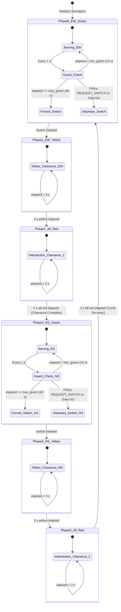
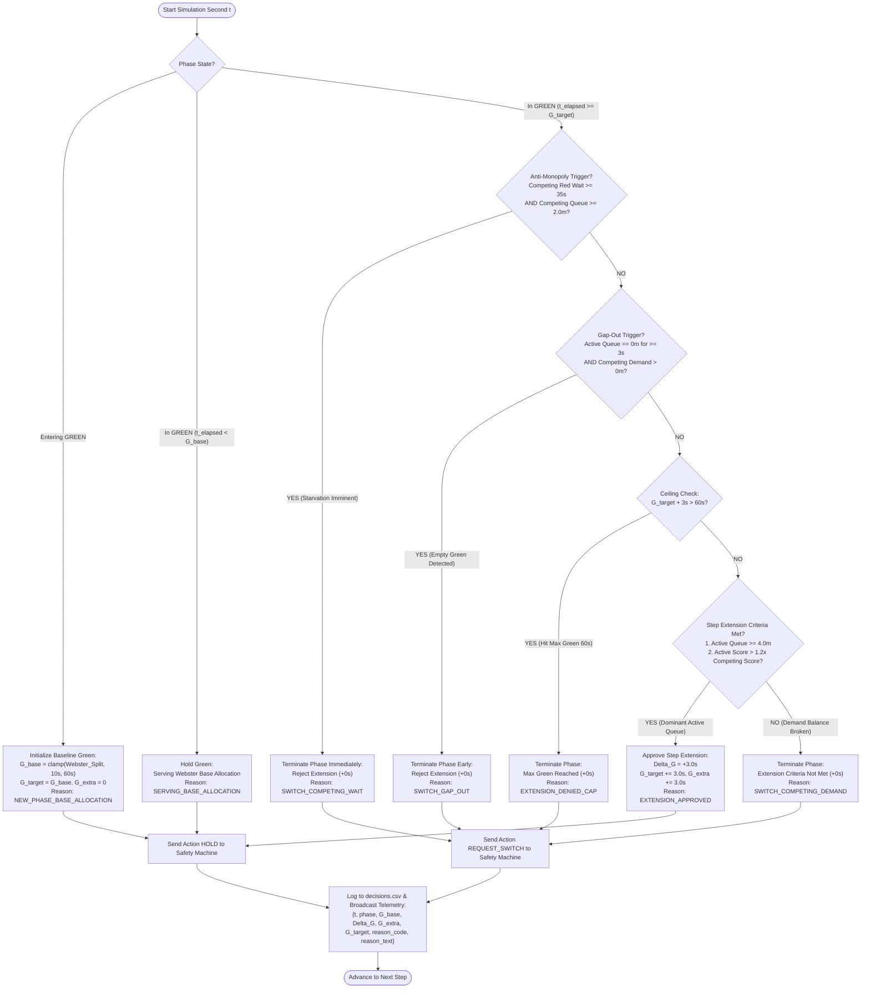
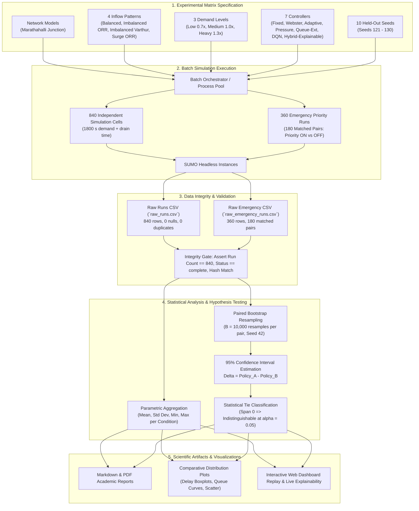

# DP1 System Architecture and Workflow Flowcharts

This document specifies the authoritative system architecture, control execution loop, safety state machine, and research evaluation pipeline for Design Project 1 (DP1).

> **Scope Note:** DP1 focuses exclusively on current traffic-state-aware signal control using microscopic simulation (SUMO and TraCI). It does **not** include future-congestion prediction, LSTM/GRU/XGBoost forecasting, risk heatmaps, 20–30-minute forecasting, or route rerouting.

---

## 1. High-Level System Architecture and Data Flow

The DP1 architecture is organized into four modular layers:
1. **Simulation Environment (SUMO):** Microscopic simulation modeling road network geometry (Marathahalli corridor + flyover), multi-class vehicle dynamics, and simulated E2 lane-area queue detectors.
2. **Control & Safety Engine (Python/TraCI):** TraCI bridge querying sensor state, six signal optimization controllers, an emergency priority coordinator, and the immutable safety phase state machine.
3. **Application & API Service (FastAPI):** High-performance asynchronous REST and WebSocket API exposing simulation management, live telemetry streaming, and historical research datasets.
4. **Interactive Dashboard (React / Vite):** Modern web interface featuring SVG canvas visualization of road topology, dynamic zoom/pan controls, real-time signal heads, queue graphs, and metric comparisons.

```mermaid
graph TD
    subgraph Simulation_Layer["1. Microscopic Simulation Environment (SUMO)"]
        NET["Road Network Model<br/>(Marathahalli / Synthetic 4-Way)"]
        DEMAND["Synthetic Demand Generator<br/>(Poisson Inflow, 4 Patterns, 3 Levels)"]
        E2["Simulated E2 Lane-Area Detectors<br/>(Queue Length in Metres)"]
        TLS["Traffic Light Signal System<br/>(16 Signal Heads, 2-Phase + Clearances)"]
        EV["Emergency Vehicles<br/>(Ambulance Inflow & GPS Proximity)"]
        
        DEMAND --> NET
        EV --> NET
        NET --> E2
        TLS --> NET
    end

    subgraph Control_Layer["2. Python Control Engine (TraCI)"]
        TRACI["TraCI Python Interface<br/>(Step-by-Step Simulation Actuation)"]
        
        subgraph Policies["Control Policies"]
            P1["1. Fixed BTP Plan"]
            P2["2. Fixed Webster Plan"]
            P3["3. Adaptive Queue-Based"]
            P4["4. Max-Pressure Differential"]
            P5["5. Bounded Queue-Extension"]
            P6["6. RL DQN Agent (Inference)"]
            P7["7. Hybrid Queue-Adaptive (Explainable)"]
        end
        
        EVSP["Emergency Coordinator (EVSP)<br/>(Distance Threshold: 100m)"]
        SAFETY["Safety Phase State Machine<br/>(GREEN -> YELLOW 3s -> ALL-RED 2s -> GREEN)"]
        SEAM["Action Seam / Bounds Guard<br/>(min_green: 10s, max_green: 60s)"]
        
        E2 -->|Queue lengths (m)| TRACI
        TRACI -->|State vector / queues| Policies
        TRACI -->|Vehicle positions| EVSP
        Policies -->|Green duration / action| SEAM
        EVSP -->|Priority override action| SEAM
        SEAM -->|Validated transitions| SAFETY
        SAFETY -->|Light state string (e.g., rrrrGGGg...)| TRACI
        TRACI -->|Actuation commands| TLS
    end

    subgraph Service_Layer["3. Backend API Service (FastAPI)"]
        API["FastAPI REST & Telemetry Server<br/>(Uvicorn ASGI)"]
        METRICS["Metrics Collector<br/>(Waiting Time, Time Loss, Queues, Throughput)"]
        RESEARCH_STORE["Research Results Repository<br/>(CSVs, Manifests, Replays)"]
        
        TRACI --> METRICS
        METRICS --> API
        RESEARCH_STORE --> API
    end

    subgraph Frontend_Layer["4. Interactive Web Dashboard (React / Vite)"]
        UI["React 18 SPA + Vite"]
        CANVAS["SVG Network Canvas<br/>(Static Geometry, Pan/Zoom, Signal Heads)"]
        TELEMETRY_PANEL["Live Telemetry & Metrics Charts<br/>(Recharts Delay, Queue, EV Status)"]
        REPLAY_PANEL["Research Matrix Explorer<br/>(720-Cell & 360-Run Analysis)"]
        
        API -->|JSON REST / Streaming| UI
        UI --> CANVAS
        UI --> TELEMETRY_PANEL
        UI --> REPLAY_PANEL
    end
```

---

## 2. Microscopic Closed-Loop Execution Workflow

At every 1-second simulation time step, the system executes a deterministic sense-decide-act loop. The control algorithm only dictates green duration or discrete switch intents; the safety state machine strictly dictates whether a transition is legally permitted.

```mermaid
sequenceDiagram
    autonumber
    participant SUMO as SUMO Micro-Simulator
    participant TRACI as TraCI Python Client
    participant SENSORS as E2 Detector Monitor
    participant CTRL as Active Controller
    participant EVSP as EVSP Coordinator
    participant STATE as Safety State Machine

    SUMO->>TRACI: Simulation step completed (t -> t + 1s)
    TRACI->>SENSORS: Read detector queues (m) per lane
    SENSORS-->>CTRL: Provide current approach queue lengths Q(t)
    
    opt Emergency Vehicle in Simulation
        TRACI->>EVSP: Query vehicle positions & distance to stopline
        EVSP->>EVSP: Evaluate distance <= 100m & approach axis
    end

    alt During GREEN Phase
        CTRL->>CTRL: Evaluate decision logic (elapsed vs target / threshold)
        alt EVSP Priority Active
            EVSP->>STATE: Request Preemption (Hold or Switch)
        else Normal Policy Evaluation
            CTRL->>STATE: Action (HOLD or REQUEST_SWITCH)
        end
        
        STATE->>STATE: Check bounds: elapsed >= min_green (10s)?
        alt elapsed < min_green
            STATE->>STATE: Reject switch; Remain GREEN
        else elapsed >= max_green (60s) OR switch accepted
            STATE->>STATE: Transition to YELLOW (3s)
            STATE->>TRACI: Set Signal String (e.g., rrrryyyyrrrryyyy)
        end
    else During YELLOW Phase
        STATE->>STATE: Check elapsed yellow >= 3s?
        alt 3s Elapsed
            STATE->>STATE: Transition to ALL-RED (2s)
            STATE->>TRACI: Set Signal String (rrrrrrrrrrrrrrrr)
        end
    else During ALL-RED Phase
        STATE->>STATE: Check elapsed all-red >= 2s?
        alt 2s Elapsed
            STATE->>STATE: Transition to next legal GREEN(competing axis)
            STATE->>CTRL: Call decide_green(new_axis, Q(t))
            CTRL-->>STATE: Establish target green duration
            STATE->>TRACI: Set Signal String (e.g., GGGgrrrrGGGgrrrr)
        end
    end

    TRACI->>SUMO: Advance simulation with updated light state
```

---

## 3. Immutable Safety State Machine

Safety is enforced as an architectural invariant that cannot be circumvented by any algorithm (including reinforcement learning agents or priority preemption):
1. **Green-to-green transitions are impossible:** Every change in axis must transition through yellow and all-red.
2. **Conflicting greens are impossible:** Orthogonal approaches (NS and EW) can never have green simultaneously.
3. **Minimum green is guaranteed:** No switch can occur before at least $10.0\text{ s}$ of green has elapsed.
4. **Maximum green is enforced:** No phase can hold green longer than $60.0\text{ s}$, preventing corridor starvation.



---

## 4. Explainable Hybrid Dynamic Controller Decision Engine Flowchart

The Explainable Hybrid Controller (`hybrid_queue_adaptive`) integrates macroscopic Webster baseline splits with real-time microscopic queue step extensions, anti-monopoly bounds, and auditable natural-language rationale generation:



---

## 5. Research Evaluation & Statistical Analysis Pipeline (840-Cell Matrix)

The empirical evaluation of DP1 follows a reproducible batch experimentation pipeline benchmarking 7 controllers across 840 independent simulation cells:


