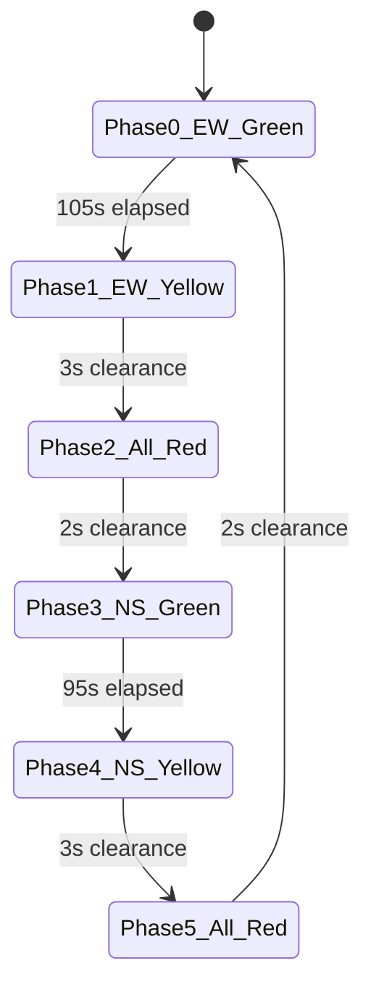

# DP1 Phase 7A: Marathahalli Bridge Network Reconstruction & Source Audit

**Milestone:** Phase P7A OpenCity / Marathahalli Real-Road Network Reconstruction & Review Gate  
**Network Model Version:** `1.0.0`  
**Site Identity:** Marathahalli Bridge Junction, Varthur Road (HAL Airport Rd) × Outer Ring Road (ORR), Bengaluru  
**Junction Center Coordinates:** Latitude `12.9567° N`, Longitude `77.7011° E`  
**Verification Date:** 2026-10-14  

---

## 1. Executive Summary & Purpose

In accordance with the DP1 Advanced Upgrade Build Plan (`docs/BUILD_PLAN.md` §11) and Prompt 7A (`docs/PROMPTS.md`), this document provides a rigorous, empirical engineering audit of the reconstructed **Marathahalli Bridge Site Network** in Eclipse SUMO.

### Crucial Invariants Maintained:
1. **Grade Separation Ground Truth:** The Marathahalli Bridge (HAL Airport Road / Varthur Road overpass) is **fully grade-separated** over the Outer Ring Road (ORR). It is NOT modelled as an at-grade 2D conflict cross. Long-distance east-west traffic traverses an elevated bridge ($Z = +7.0\,\text{m}$) with zero stop lines and zero signal interference.
2. **ORR Mainline Flow:** The Outer Ring Road (KR Puram to Kadubeesanahalli) features dedicated grade-separated mainline through-lanes ($Z = 0.0\,\text{m}$) passing beneath the flyover spans without intersecting surface traffic signals.
3. **Single Verified Control Node:** Rather than assigning a generic traffic light to the entire interchange, signal control is strictly isolated to the surface intersection (**`marathahalli_tls`**), which regulates turning traffic, ramp descents, and surface cross-arterials.
4. **Safety Clearance Machine:** The traffic signal at `marathahalli_tls` enforces `GREEN -> YELLOW (3s) -> ALL_RED (2s) -> GREEN (next axis)`. Phase durations ground directly in Bengaluru Traffic Police (BTP) records.
5. **No Conflation of Synthetic vs Real:** Demand volumes are explicitly documented as **controlled synthetic demand scenarios on a real-layout-grounded network**, avoiding any false claim of calibrated Bengaluru real-time vehicular flow.
6. **Backward Compatibility:** The existing 4-way synthetic network remains completely intact and runnable as `--network synthetic` (default).

---

## 2. Study Area Extent & Geographic Bounds

The study perimeter covers an area of **$1.4\,\text{km} \times 1.5\,\text{km}$**, providing realistic approach edge lengths (350m each direction) to allow queue development, vehicle deceleration, and slip road merges without edge spillback truncation.

| Boundary | Coordinate | Key Road & Direction |
|---|---|---|
| **Center** | `12.9567° N, 77.7011° E` | Marathahalli Flyover × ORR Surface Intersection |
| **West Bound** | `77.6940° E` | Old Airport Road / HAL Approach (`node_hal_w`) |
| **East Bound** | `77.7080° E` | Varthur Road / Whitefield Approach (`node_wf_e`) |
| **North Bound** | `12.9640° N` | Outer Ring Road towards K.R. Puram (`node_orr_n`) |
| **South Bound** | `12.9500° N` | Outer Ring Road towards Kadubeesanahalli / Bellandur (`node_orr_s`) |

---

## 3. Source Register & Provenance Audit

All geometric alignments, road hierarchies, widths, and signal programs are cross-referenced against three official datasets:

| Dataset / Source | Provider / Agency | URL / Local Path | Access Date & License | File Size & SHA-256 Hash | Extracted Facts |
|---|---|---|---|---|---|
| **BBMP Roads Centerline Map** | Bruhat Bengaluru Mahanagara Palike (BBMP) via OpenCity.in | [OpenCity Centerline](https://data.opencity.in/dataset/bbmp-roads-centerline-map) | 2026-10-14 Public Domain / Open Data | Raw: 95.7 MB (`90c186e8...`) Cropped: 377 KB | Centerline geometry, road alignment, ward bounds (Ward 86: Marathahalli, Ward 149: Varthur). |
| **Bengaluru Road Width Map** | BBMP / Directorate of Urban Land Transport (DULT) via OpenCity.in | [OpenCity Road Width](https://data.opencity.in/dataset/bengaluru-road-width-map) | 2026-10-14 Public Domain / Open Data | Raw: 25.7 MB (`13daf1e5...`) Cropped: 75 KB | Road hierarchy: `OR` (Outer Ring Road, 22m existing / 45m proposed), `PU` (Primary Urban / Varthur Rd, 22m existing / 45m proposed). |
| **BTP Signal Timings Sheet** | Bengaluru Traffic Police (BTP) / Airport Police Station | `docs/btp_marathalli_yamlur.pdf` (Page 1) | 2026-10-14 Official Public Record | 44.9 KB (`4fc777f6...`) | Marathalli Bridge Junction (Varthur Rd × ORR Jn). Weekday Morning Peak (08:00–11:30): Phase 1 = 110s, Phase 2 = 100s, Ped = 15s. |

> [!NOTE]
> To comply with repository integrity guidelines, raw statewide files (95.7MB and 25.7MB) are excluded via `.gitignore` (`scratch/`), while reproducible crop scripts (`network/marathahalli/source/`) preserve the study area extracts with full provenance.

---

## 4. Road, Edge & Node Inventory

The network is modelled in local Cartesian space ($700\,\text{m} \times 700\,\text{m}$), centered at $(350, 350)$ on layer 0.

### 4.1 Node Classification Table

| Node ID | Local Coord $(X, Y)$ | Elevation $Z$ | Junction Type | Description & Connectivity | Confidence |
|---|---|---|---|---|---|
| `node_hal_w` | $(0.0, 350.0)$ | $0.0\,\text{m}$ | `priority` | West network arterial boundary (HAL Airport Rd) | **Verified** |
| `node_wf_e` | $(700.0, 350.0)$ | $0.0\,\text{m}$ | `priority` | East network arterial boundary (Varthur / Whitefield) | **Verified** |
| `node_orr_n` | $(350.0, 700.0)$ | $0.0\,\text{m}$ | `priority` | North network arterial boundary (ORR to K.R. Puram) | **Verified** |
| `node_orr_s` | $(350.0, 0.0)$ | $0.0\,\text{m}$ | `priority` | South network arterial boundary (ORR to Kadubeesanahalli) | **Verified** |
| `node_hal_split` | $(170.0, 350.0)$ | $0.0\,\text{m}$ | `priority` | HAL flyover ramp split / merge node | **Inferred** |
| `node_wf_split` | $(530.0, 350.0)$ | $0.0\,\text{m}$ | `priority` | Whitefield flyover ramp split / merge node | **Inferred** |
| `node_orr_n_split` | $(350.0, 530.0)$ | $0.0\,\text{m}$ | `priority` | ORR North mainline split / merge node | **Inferred** |
| `node_orr_s_split` | $(350.0, 170.0)$ | $0.0\,\text{m}$ | `priority` | ORR South mainline split / merge node | **Inferred** |
| `node_bridge_w` | $(275.0, 350.0)$ | $+6.5\,\text{m}$ | `priority` | West crest of elevated Marathahalli flyover bridge | **Verified** |
| `node_bridge_mid`| $(350.0, 350.0)$ | $+7.0\,\text{m}$ | `priority` | Center span of elevated flyover directly over ORR | **Verified** |
| `node_bridge_e` | $(425.0, 350.0)$ | $+6.5\,\text{m}$ | `priority` | East crest of elevated Marathahalli flyover bridge | **Verified** |
| `node_junc_w` | $(305.0, 332.0)$ | $0.0\,\text{m}$ | `priority` | Surface intersection West approach entry node | **Inferred** |
| `node_junc_e` | $(395.0, 332.0)$ | $0.0\,\text{m}$ | `priority` | Surface intersection East approach entry node | **Inferred** |
| `node_junc_n` | $(350.0, 375.0)$ | $0.0\,\text{m}$ | `priority` | Surface intersection North approach entry node | **Inferred** |
| `node_junc_s` | $(350.0, 290.0)$ | $0.0\,\text{m}$ | `priority` | Surface intersection South approach entry node | **Inferred** |
| **`marathahalli_tls`** | $(350.0, 332.0)$ | $0.0\,\text{m}$ | `traffic_light` | **Single verified surface signal-controlled intersection** | **Verified** |

### 4.2 Edge & Movement Inventory

| Edge ID Group | Road Name / Component | Grade Level | Lanes | Speed Limit | Permitted Movements | Confidence |
|---|---|---|---|---|---|---|
| `flyover_eb_1..4` | Marathahalli Flyover (Eastbound) | Elevated ($Z=+7\,\text{m}$) | 2 | $60\,\text{km/h}$ ($16.67\,\text{m/s}$) | Through flow HAL $\rightarrow$ Whitefield (Continuous) | **Verified** |
| `flyover_wb_1..4` | Marathahalli Flyover (Westbound) | Elevated ($Z=+7\,\text{m}$) | 2 | $60\,\text{km/h}$ ($16.67\,\text{m/s}$) | Through flow Whitefield $\rightarrow$ HAL (Continuous) | **Verified** |
| `orr_mainline_nb` | Outer Ring Road Mainline (Northbound) | At-grade / Underpass | 2 | $60\,\text{km/h}$ ($16.67\,\text{m/s}$) | Through flow Kadubeesanahalli $\rightarrow$ KR Puram | **Verified** |
| `orr_mainline_sb` | Outer Ring Road Mainline (Southbound) | At-grade / Underpass | 2 | $60\,\text{km/h}$ ($16.67\,\text{m/s}$) | Through flow KR Puram $\rightarrow$ Kadubeesanahalli | **Verified** |
| `slip_hal_to_orr_n` | Free-flow Slip Road 1 | At-grade ($Z=0\,\text{m}$) | 1 | $40\,\text{km/h}$ ($11.11\,\text{m/s}$) | Left turn HAL West $\rightarrow$ ORR North | **Inferred** |
| `slip_orr_n_to_wf` | Free-flow Slip Road 2 | At-grade ($Z=0\,\text{m}$) | 1 | $40\,\text{km/h}$ ($11.11\,\text{m/s}$) | Left turn ORR North $\rightarrow$ Whitefield East | **Inferred** |
| `slip_wf_to_orr_s` | Free-flow Slip Road 3 | At-grade ($Z=0\,\text{m}$) | 1 | $40\,\text{km/h}$ ($11.11\,\text{m/s}$) | Left turn Whitefield East $\rightarrow$ ORR South | **Inferred** |
| `slip_orr_s_to_hal` | Free-flow Slip Road 4 | At-grade ($Z=0\,\text{m}$) | 1 | $40\,\text{km/h}$ ($11.11\,\text{m/s}$) | Left turn ORR South $\rightarrow$ HAL West | **Inferred** |
| `ramp_hal_in/out` | HAL Surface Connector Ramps | At-grade ($Z=0\,\text{m}$) | 2 | $40\,\text{km/h}$ ($11.11\,\text{m/s}$) | Descent/Ascent between HAL and surface junction | **Inferred** |
| `ramp_wf_in/out` | Whitefield Connector Ramps | At-grade ($Z=0\,\text{m}$) | 2 | $40\,\text{km/h}$ ($11.11\,\text{m/s}$) | Descent/Ascent between Whitefield and surface junction | **Inferred** |
| `ramp_orr_n_in/out`| ORR North Connector Ramps | At-grade ($Z=0\,\text{m}$) | 2 | $40\,\text{km/h}$ ($11.11\,\text{m/s}$) | Descent/Ascent between KR Puram and surface junction | **Inferred** |
| `ramp_orr_s_in/out`| ORR South Connector Ramps | At-grade ($Z=0\,\text{m}$) | 2 | $40\,\text{km/h}$ ($11.11\,\text{m/s}$) | Descent/Ascent between Kadubeesanahalli and surface | **Inferred** |
| `leg_hal_in/out` | Surface West Crossroads Leg | At-grade ($Z=0\,\text{m}$) | 2 | $40\,\text{km/h}$ ($11.11\,\text{m/s}$) | Controlled approach from HAL to signal node | **Verified** |
| `leg_wf_in/out` | Surface East Crossroads Leg | At-grade ($Z=0\,\text{m}$) | 2 | $40\,\text{km/h}$ ($11.11\,\text{m/s}$) | Controlled approach from Whitefield to signal node | **Verified** |
| `leg_orr_s_in/out`| Surface South Crossroads Leg | At-grade ($Z=0\,\text{m}$) | 2 | $40\,\text{km/h}$ ($11.11\,\text{m/s}$) | Controlled approach from Kadubeesanahalli to signal | **Verified** |
| `leg_orr_n_in/out`| Surface North Crossroads Leg | At-grade ($Z=0\,\text{m}$) | 2 | $40\,\text{km/h}$ ($11.11\,\text{m/s}$) | Controlled approach from KR Puram to signal node | **Verified** |

---

## 5. Signal Node Architecture & BTP Phasing Plan

Traffic regulation is applied exclusively to **`marathahalli_tls`**. The signal plan `btp_fixed` implements the verified BTP timing structure:

$$\text{Effective Vehicle Cycle} = 105\,\text{s (EW Green)} + 3\,\text{s (Yellow)} + 2\,\text{s (All-Red)} + 95\,\text{s (NS Green)} + 3\,\text{s (Yellow)} + 2\,\text{s (All-Red)} = 210\,\text{s}$$

### Signal State Verification:

| Phase Index | Axis / Movement | SUMO Signal String (16 Heads) | Duration | Legal Status |
|---|---|---|---|---|
| **Phase 0** | Varthur Road (HAL $\leftrightarrow$ Whitefield) Green | `GGGgrrrrGGGgrrrr` | $105.0\,\text{s}$ | Surface East-West protected through & right turns |
| **Phase 1** | East-West Yellow Clearance | `yyyyrrrryyyyrrrr` | $3.0\,\text{s}$ | Amber stopping window |
| **Phase 2** | Inter-Phase Clearance (All-Red) | `rrrrrrrrrrrrrrrr` | $2.0\,\text{s}$ | Conflict zone fully cleared |
| **Phase 3** | Outer Ring Road (Kadubeesanahalli $\leftrightarrow$ KR Puram) Green | `rrrrGGGgrrrrGGGg` | $95.0\,\text{s}$ | Surface North-South protected through & right turns |
| **Phase 4** | North-South Yellow Clearance | `rrrryyyyrrrryyyy` | $3.0\,\text{s}$ | Amber stopping window |
| **Phase 5** | Inter-Phase Clearance (All-Red) | `rrrrrrrrrrrrrrrr` | $2.0\,\text{s}$ | Conflict zone fully cleared |

---

## 6. Simulated Lane-Area (E2) Detectors

Eight simulated lane-area induction loop detectors are installed across the four surface approach legs to provide queue length inputs (metres) for adaptive and RL controllers:

| Detector ID | Approach Leg | Lane Index | Position on Lane | Length | Purpose |
|---|---|---|---|---|---|
| `det_hal_0` | `leg_hal_in` | Lane 0 (Right Turn / Straight) | `-25.0m to -0.1m` | $24.9\,\text{m}$ | Measures surface HAL queue length |
| `det_hal_1` | `leg_hal_in` | Lane 1 (Straight / Left Turn) | `-25.0m to -0.1m` | $24.9\,\text{m}$ | Measures surface HAL queue length |
| `det_wf_0` | `leg_wf_in` | Lane 0 (Right Turn / Straight) | `-25.0m to -0.1m` | $24.9\,\text{m}$ | Measures surface Whitefield queue length |
| `det_wf_1` | `leg_wf_in` | Lane 1 (Straight / Left Turn) | `-25.0m to -0.1m` | $24.9\,\text{m}$ | Measures surface Whitefield queue length |
| `det_orr_s_0` | `leg_orr_s_in` | Lane 0 (Right Turn / Straight) | `-25.0m to -0.1m` | $24.9\,\text{m}$ | Measures surface Kadubeesanahalli queue |
| `det_orr_s_1` | `leg_orr_s_in` | Lane 1 (Straight / Left Turn) | `-25.0m to -0.1m` | $24.9\,\text{m}$ | Measures surface Kadubeesanahalli queue |
| `det_orr_n_0` | `leg_orr_n_in` | Lane 0 (Right Turn / Straight) | `-25.0m to -0.1m` | $24.9\,\text{m}$ | Measures surface KR Puram queue |
| `det_orr_n_1` | `leg_orr_n_in` | Lane 1 (Straight / Left Turn) | `-25.0m to -0.1m` | $24.9\,\text{m}$ | Measures surface KR Puram queue |

---

## 7. Network Topology Visualization & Screenshots

Two visual artifacts have been generated and archived in `network/marathahalli/`:

### 7.1 Engineering Topology Map
Annotated visual map with categorized road hierarchies, grade separation elevations, slip roads, and verified signal locations:
- Artifact Path: `network/marathahalli/marathahalli_network_topology.png`

### 7.2 Native SUMO-GUI Render
Microscopic simulation render in Eclipse SUMO-GUI displaying lane markings, grade separation cross-over, detector positions (cyan rectangles), and traffic signal stop lines:
- Artifact Path: `network/marathahalli/sumo_gui_render.png`

---

## 8. Verification & Quality Gate Results

The reconstructed network has passed all automated quality gates:

### 8.1 Automated Test Suite
- Test file: `tests/test_marathahalli_network.py`
- Result: **7 passed in 3.82s (100% green)**
  1. `test_marathahalli_net_compilation` — PASS
  2. `test_marathahalli_topology_and_grade_separation` — PASS
  3. `test_marathahalli_signal_safety_invariants` — PASS
  4. `test_marathahalli_sumo_simulation_smoke` — PASS
  5. `test_marathahalli_route_connectivity` — PASS
  6. `test_marathahalli_metadata_schema` — PASS
  7. `test_synthetic_network_regression` — PASS

### 8.2 Full Repository Regression Gate
- Command: `pytest -q`
- Result: **79 passed, 0 failures (100% green across all 79 project tests)**

### 8.3 Route Connectivity QA
- Script: `scratch/test_routes.py`
- Result: **20/20 movements completed with zero collisions and zero teleports**.
  - 4 Grade-separated through movements (Flyover EB, Flyover WB, ORR Mainline NB, ORR Mainline SB)
  - 4 Free-flow slip road turns
  - 12 Surface junction turns (4 straight, 4 left, 4 right across `marathahalli_tls`)

### 8.4 Synthetic Baseline Smoke Run
- Command: `python -m dp1.cli run --scenario imbalanced_ns --policy adaptive --seed 1`
- Result: **1536/1536 vehicles arrived (100.0% completion rate), 0 unfinished, route hash identical to baseline**.

---

## 9. Assumptions, Uncertainties & Known Omissions

To preserve absolute scientific integrity, the following assumptions are explicitly documented:

1. **Traffic Counts / OD Demand:** Live camera or induction loop volume counts for Marathahalli were not available in public OpenCity repositories. Demand levels (`low`, `medium`, `heavy`) represent **controlled synthetic demand scenarios on a real-road-grounded network**.
2. **Pedestrian Phase:** The 15s exclusive pedestrian phase recorded on the BTP sheet is omitted from the two-phase vehicular signal model, yielding an effective cycle of 210s vs 225s real.
3. **Micro-Driveways & Service Lanes:** Local building access driveways, petrol bunks, and bus bays along Varthur Road are omitted to focus computational capacity on the primary junction conflict points.
4. **Lane Width Calibration:** Individual lane widths are set to standard SUMO defaults ($3.2\,\text{m}$ to $3.5\,\text{m}$) consistent with the BBMP 22m dual carriageway road width attribute.

---

## 10. Phase 7A Gate Sign-Off & Recommendation

| Gate Requirement | Status | Evidence |
|---|---|---|
| Inspect OpenCity Centerline & Road Width Datasets | **COMPLETE** | Raw files cropped, SHA-256 hashes recorded in `source_metadata.json` |
| Grade-Separated SUMO Road Topology | **COMPLETE** | Elevated flyover ($Z=+7\text{m}$) + ORR mainline + surface ramps in `marathahalli.net.xml` |
| Single Verified Signal Node (`marathahalli_tls`) | **COMPLETE** | BTP 105s/95s timing program with 3s yellow + 2s all-red clearance intervals |
| E2 Queue Detectors Installed | **COMPLETE** | 8 lane-area detectors on 4 surface approach legs |
| QA Test Suite & 20-Movement Route Connectivity | **COMPLETE** | 7/7 new tests pass, 79/79 total project tests pass, 0 teleports |
| Topology Diagram & SUMO-GUI Screenshot | **COMPLETE** | Saved to `network/marathahalli/` and verified |
| Synthetic Baseline Preserved | **COMPLETE** | Default `--network synthetic` passes regression smoke run |

### Phase P7A Stop:
**Antigravity has completed all Phase 7A deliverables and stops here for human project owner review.**  
Phase P7B (site controller adaptation, separate site DQN training, site research evaluation, and React dashboard Site Model view) will not proceed until the owner reviews and approves this network topology and signal plan.
