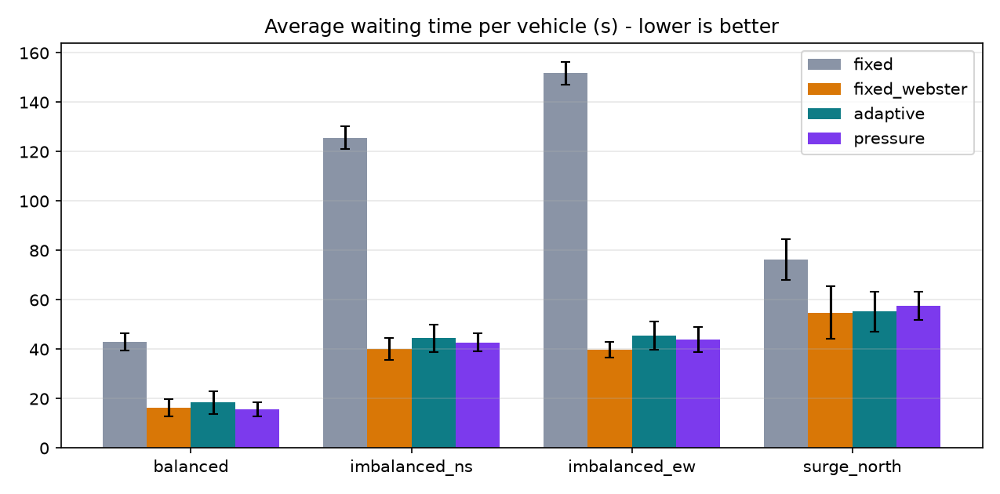
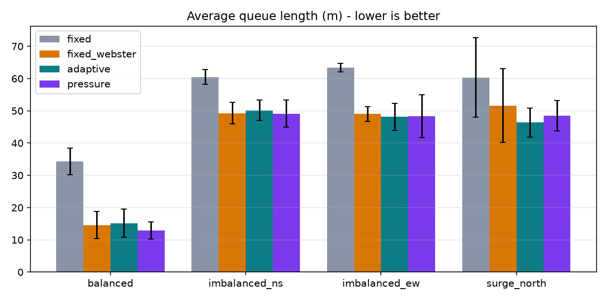
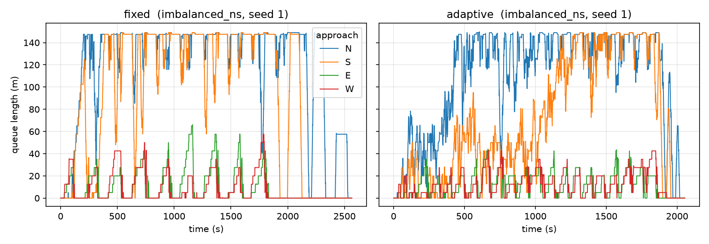

# DP1 Simulation Experiment Report: Adaptive Traffic Signal Optimisation

This report is generated dynamically from simulation run results (`results/all_runs.csv`). It provides a rigorous, fair comparison across traffic demand scenarios between the fixed-time baseline and adaptive signal control policies.

## 1. Experimental Results & Scenario Comparison

### 1.1 Average Waiting Time per Vehicle (s)

*Lower is better. Values represent Mean ± Standard Deviation over all evaluated seeds.*

| Scenario | Fixed (s) | Adaptive (s) | Adaptive vs Fixed (%) | Pressure (s) | Pressure vs Fixed (%) | Fixed_webster (s) | Fixed_webster vs Fixed (%) |
| :--- | :---: | :---: | :---: | :---: | :---: | :---: | :---: |
| **balanced** | 43.03 ± 3.56 | 18.41 ± 4.71 | -57.2% | 15.62 ± 2.87 | -63.7% | 16.32 ± 3.46 | -62.1% |
| **imbalanced_ns** | 125.64 ± 4.60 | 44.47 ± 5.50 | -64.6% | 42.71 ± 3.62 | -66.0% | 40.18 ± 4.55 | -68.0% |
| **imbalanced_ew** | 151.78 ± 4.51 | 45.55 ± 5.73 | -70.0% | 43.86 ± 5.09 | -71.1% | 39.86 ± 3.14 | -73.7% |
| **surge_north** | 76.34 ± 8.31 | 55.22 ± 8.11 | -27.7% | 57.66 ± 5.77 | -24.5% | 54.83 ± 10.70 | -28.2% |

### 1.2 Average Queue Length (m)

*Lower is better. Jam length measured back from the stop line by lane-area detectors.*

| Scenario | Fixed (m) | Adaptive (m) | Adaptive vs Fixed (%) | Pressure (m) | Pressure vs Fixed (%) | Fixed_webster (m) | Fixed_webster vs Fixed (%) |
| :--- | :---: | :---: | :---: | :---: | :---: | :---: | :---: |
| **balanced** | 34.32 ± 4.12 | 15.16 ± 4.36 | -55.8% | 12.86 ± 2.65 | -62.5% | 14.59 ± 4.14 | -57.5% |
| **imbalanced_ns** | 60.50 ± 2.26 | 50.17 ± 3.12 | -17.1% | 49.12 ± 4.22 | -18.8% | 49.27 ± 3.29 | -18.6% |
| **imbalanced_ew** | 63.38 ± 1.36 | 48.11 ± 4.22 | -24.1% | 48.31 ± 6.61 | -23.8% | 49.02 ± 2.25 | -22.7% |
| **surge_north** | 60.32 ± 12.35 | 46.35 ± 4.53 | -23.2% | 48.49 ± 4.68 | -19.6% | 51.65 ± 11.47 | -14.4% |

### 1.3 System Throughput (veh/h)

*Higher is better. Completed vehicles per hour during the evaluation window.*

| Scenario | Fixed (veh/h) | Adaptive (veh/h) | Adaptive vs Fixed (%) | Pressure (veh/h) | Pressure vs Fixed (%) | Fixed_webster (veh/h) | Fixed_webster vs Fixed (%) |
| :--- | :---: | :---: | :---: | :---: | :---: | :---: | :---: |
| **balanced** | 2516.80 ± 29.38 | 2554.40 ± 20.85 | +1.5% | 2569.60 ± 33.06 | +2.1% | 2560.80 ± 27.00 | +1.7% |
| **imbalanced_ns** | 2392.00 ± 35.67 | 2777.60 ± 58.04 | +16.1% | 2789.60 ± 62.92 | +16.6% | 2736.00 ± 45.45 | +14.4% |
| **imbalanced_ew** | 2190.80 ± 28.59 | 2761.60 ± 25.27 | +26.1% | 2775.20 ± 35.74 | +26.7% | 2722.00 ± 32.62 | +24.2% |
| **surge_north** | 2785.60 ± 70.21 | 2822.40 ± 50.74 | +1.3% | 2815.60 ± 41.94 | +1.1% | 2778.80 ± 63.85 | -0.2% |

## 2. Performance Visualizations

Comparative charts generated from the experiment matrix:

*Figure 1: Average waiting time per vehicle (s) by scenario and policy.*

*Figure 2: Average queue length (m) by scenario and policy.*

*Figure 3: Queue length timeseries comparison across approaches.*

## 3. Known Limitations (docs/SPEC.md Section 9)

As explicitly documented in `docs/SPEC.md` section 9, the following limitations govern this phase of the study:

1. **Approach Lane Geometry**: Simulated 4-way cross junction with synthetic 2-lane approaches, without dedicated turn bays or real-world lane tapers.
2. **Detector Sensing Cap**: Lane-area detectors cover 150 m before the stop line; queues spilling beyond 150 m saturate sensor jam readings.
3. **No Pedestrian Modelling**: Pedestrian crossing phases are omitted (e.g., the 15 s exclusive pedestrian phase present in the BTP Marathalli plan is excluded from the modelled cycle).
4. **Simple Two-Phase Plan**: Traffic signal operates two alternating phases (NS and EW) with permissive turning rather than multi-phase protected right-turns.
5. **Simulator vs Field Telemetry**: All sensor measurements and driver behaviours originate from SUMO micro-simulation, not real-world street cameras or loop detector feeds.

## 4. Experimental Setup & Configuration Values

- **Evaluated Seeds**: `[1, 2, 3, 4, 5]` (5 random seeds)
- **Demand Scenarios Evaluated**: `['balanced', 'imbalanced_ns', 'imbalanced_ew', 'surge_north']`
- **Policies Evaluated**: `['fixed', 'fixed_webster', 'adaptive', 'pressure']`
- **Demand Duration**: `1800 s` (Drain cap: `3600 s`)
- **Demand Scale Factor**: `1.7`

### Signal Timing & Invariant Clearances (`dp1.config.TIMING`)
- Yellow Duration: `3 s`
- All-Red Clearance: `2 s` (enforces strict Green -> Yellow -> All-Red -> Green invariant)

### Baseline Fixed-Time Controller (`dp1.config.FIXED`)
- Calibrated from BTP Marathalli Bridge Junction (Varthur Rd x ORR, weekday 08:00-11:30)
- NS Green: `105 s`
- EW Green: `95 s`
- Modelled Cycle: `210 s`

### Adaptive Queue Controller (`dp1.config.ADAPTIVE`)
- Min Green: `10 s` | Max Green: `60 s`
- Queue Scaling factor (`k_s_per_m`): `0.3 s/m`
- Gap-out duration: `3 s`
- Extend threshold: `15.0 m`
- Competing queue threshold: `1.0 m`

### Adaptive Pressure Controller (`dp1.config.PRESSURE`)
- Min Green: `10 s` | Max Green: `60 s`
- Pressure Queue Differential factor (`k_s_per_m`): `0.3 s/m`
- Gap-out duration: `3 s`
- Extend threshold: `15.0 m`
- Competing queue threshold: `1.0 m`

### Network Geometry (`dp1.config.NET`)
- Lanes per approach: `2`
- Approach length: `300.0 m`
- Detector length: `150.0 m`
- Speed limit: `13.89 m/s` (50 km/h)
